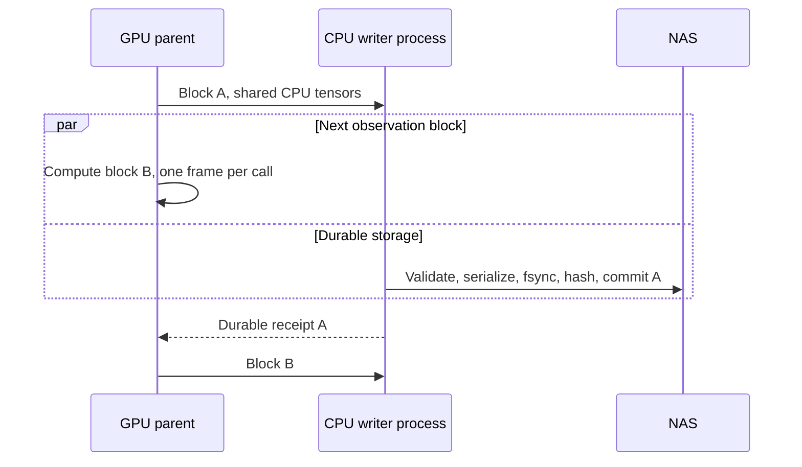

# ReKV (Qwen2.5-VL-7B adaptation)

This baseline archives query-independent, per-layer **pre-RoPE K/V** using a
frozen Qwen2.5-VL backbone. It does not train a model, retrieve question-specific
memory, or answer questions. Those last two stages are deferred.

Read [OFFICIAL_REVIEW.md](OFFICIAL_REVIEW.md) for the pinned official ReKV code,
paper/code differences, and the backbone-dependent adaptation. This is an
explicit Qwen2.5-VL adaptation, not an official released ReKV Qwen2.5 backend.

## Pinned inputs

- Backbone: `Qwen/Qwen2.5-VL-7B-Instruct`, revision
  `cc594898137f460bfe9f0759e9844b3ce807cfb5`.
- Official ReKV source: `Becomebright/ReKV`, commit
  `5a17285d5e1a7488228eb0098b5e586d72a73e3a`; the vendored multistage Torch
  attention implementation is checked against its original Git blob hashes.
- Model directory:
  `/convei_nas2/zzuhyun/hyunjun/models/Qwen2.5-VL-7B-Instruct`.
- Golden video: `/convei_nas2/zzuhyun/hyunjun/datasets/videomem/day{1..7}.mp4`.
- Existing visual archive:
  `/convei_nas2/zzuhyun/hyunjun/feature_archives/qwen25_day1_7_v1`, archive ID
  `6cc5df1cb4be4be1ba8a51d9c88950bc`.
- Output root: `/convei_nas2/zzuhyun/hyunjun/rekv_qwen25vl7b`.
- Runtime: `/convei_nas2/zzuhyun/hyunjun/envs/rekv-qwen25/bin/python`;
  Torch `2.5.1+cu121`, Transformers `4.57.3`, BF16, eval/inference mode.

`inputs.py` verifies checkpoint provenance and the committed visual shards,
including receipts, payload/index/frame hashes and exact inventory mapping.
Seed rows declare their size as `bytes` and/or `feature_bytes`; later producer
rows use `feature_bytes`. Every size alias present must agree with the fixed
tensor geometry. Missing or conflicting declarations are rejected.
The visual producer may still be running on another host; uncommitted features
are never consumed. Historical seed rows missing source metadata are mapped
through the same inventory rather than assigned guessed Day boundaries.

## Fixed observation protocol

The controlled comparison uses the existing 1 FPS, source-local integer-second
sampling: 221,728 frames over 221,724.92 seconds. The ReKV paper used 0.5 FPS;
the released CLI defaults to configurable 1 FPS. This choice is recorded as a
benchmark protocol difference.

Each frame is an independent image with grid `[1,52,52]`, producing
`[676,3584]` BF16 features after Qwen's spatial merger. It is not Qwen's native
paired-frame video encoding. Cache reuse was checked against actual golden
images through the native vision path.

The fixed, query-free open user prefix is encoded once in its own 17-token
call. Every subsequent call contains exactly one frame: `vision_start`, 676
image features, `vision_end`. No user-closing footer or answer/question tokens
are appended. All absolute three-axis mRoPE positions are derived from native
`get_rope_index`; each frame advances the maximum position by 28. Frame IDs and
timestamps remain separate from mRoPE positions.

The model keeps a 15,000-token local window and immutable per-layer initial
prefix sinks. Keys are captured directly from `k_proj` before mRoPE; values are
captured from `v_proj`. Every layer stores `[1,4,T,128]` K and V. The native HF
short-prefix path preserves HF's actual causal-mask dispatch. The long path
uses official joint local-plus-sink softmax with explicit three-axis local
rebasing and the declared sink rotation policy. The native chunk-end sink
exposure rule, including first-crossing overlap, is preserved.

One-frame execution is mandatory. The real-model 4/8/16-frame chunk experiments
changed K/V despite identical inputs and positions; increasing chunk size is
therefore disabled. Batch dimension is also fixed at one.

## Continuous state, temporal parallelism and resume

Independent temporal shards cannot reset context. Workers share a canonical
bitwise copy of the original per-layer prefix sinks, preserve absolute positions
and the global token counter, and retain the same one-frame call boundaries.

For 28 layers and a 15,000-token window, the conservative finite-history bound
is 420,000 tokens. A 620-frame halo supplies 420,360 tokens. A worker whose
start lies within this halo replays the entire prefix instead. Later workers
must replay the full halo before publishing anything. The real-model halo
test deliberately corrupts recent boundary K/V and requires recovery of all
layer K/V, logits **and the full bounded continuation state** against one
uninterrupted stream. A passed, hash-pinned report is required by the runner;
the mathematical bound alone does not enable parallel generation.

Archive blocks normally hold 100 frames (67,800 observation tokens). This is a
disk grouping, not a model batch. Since the block contains more than 15,000
tokens, its last raw K/V and positions reconstruct the next bounded state
exactly, together with the canonical prefix sinks. This avoids duplicating an
approximately 0.87 GB live-state snapshot in every archive block.

`archive.py` uses safetensors, per-tensor hashes, payload/index hashes, atomic
ready receipts and per-chunk writer locks. Heavy I/O occurs outside the global
manifest lock. Committed blocks are immutable. A restart verifies and reuses
completed blocks; an incomplete block is recomputed from a valid boundary.
Manifest coverage is distinct from whole-run completion.

The asynchronous worker uses a separate, spawned **CPU writer process**. After
producing block A, the GPU parent transfers ownership of shared CPU tensors to
the writer and computes block B. Before submitting B, it receives A's durable
receipt. Only that receipt advances committed progress. The queue permits one
pending block, so there can be at most one block being saved and one next block
being computed. The unchanged serializer also makes temporary CPU copies;
queue capacity is not a claim that serialization is zero-copy.



The writer has no CUDA context. Child failure, timeout, or parent death cannot
silently mark a block complete. A normal worker exit drains the final write and
joins the writer first. Resume reconstructs state from the last committed block;
computed but uncommitted blocks are recomputed.

Each index records source/Day, global frame ID, exact source/global time,
token ranges, checkpoint/config identity, layer shapes and dtype. Retrieval is
not implemented. The current archive reader accepts a cutoff timestamp and
exposes only blocks whose last frame is no later than that cutoff. Future QA
code may add within-block filtering to recover eligible frames in a partial
block; it must preserve the no-future-candidate rule.

## Validation and execution

Run commands from this directory with the pinned Python executable and
`USE_TF=0 USE_FLAX=0 HF_HUB_OFFLINE=1 TRANSFORMERS_OFFLINE=1`.

```bash
python -m pytest tests -q
python -m rekv_qwen25.smoke
python -m rekv_qwen25.streaming_smoke
python -m rekv_qwen25.halo_smoke
```

These GPU0 checks are sequential. `smoke` compares the original image path,
cached features, passive hooks, disk-restored raw K/V, reconstructed native K/V
and continuation logits for 1/4/8/16-frame inputs. `streaming_smoke` separately
checks the actual ReKV stateful path, native mask parity, the true 15K boundary,
disk continuation and chunk-size effects. `halo_smoke` checks full-model
temporal equivalence before scaling is allowed.

The 678-token observation payload is **38,879,232 bytes/frame**, or
8,620,614,352,896 bytes for all frames. Absolute positions and input IDs add
4,810,610,688 bytes. Allow approximately **8.63 TB** for the final uncompressed
archive plus indices, receipts and the small canonical prefix artifact;
benchmark artifacts are separate. This estimate does not include the existing
visual archive or model weights.

Live results and failures are recorded under `benchmarks/`, not inferred from
the presence of code. A successful smoke report is not a completed Day1–7
archive. The coordinator must separately attest all worker exits and complete,
non-overlapping global frame coverage.

The initial synchronous benchmark measured 0.674/1.078/1.465/1.572 aggregate FPS
for 1/2/4/8 GPUs, including actual NAS commits. Eight GPUs improved on four by
only 7.3%. The asynchronous writer has its own 200-frame-per-worker trials:
two blocks are necessary to observe computation/storage overlap. Reports keep
the full two-block elapsed FPS separate from the measured first-to-second
durable-commit cadence. That cadence has only one observed interval per worker;
long-run estimates explicitly retain this limitation and startup/fill costs.

The completed asynchronous trials measured:

| GPUs | Two-block end-to-end FPS | First-to-second durable-commit cadence FPS |
| --- | ---: | ---: |
| 2 | 1.332 | 1.766 |
| 4 | 1.507 | 1.561 |

All 12 asynchronous blocks matched their synchronous references bitwise, and
four shared blocks matched between the two- and four-GPU trials. Every writer
was a separate CPU-only process and drained successfully. Observed computation
overlapped storage by 70–73 seconds per worker. Two GPUs were selected for the
full run: four improved the short end-to-end trial by only 13.2%, and its measured
commit cadence was lower. The short measurements suggest approximately 35 hours
from cadence or 46 hours from the conservative two-block end-to-end rate;
neither estimate includes changes in shared NAS traffic or source waits.

`preflight-config.json`, `.v2.json`, and `.v3.json` preserve the original reader,
the compatible reader, and asynchronous writer configurations respectively.
Prior benchmark archives are immutable. Reader compatibility was checked on
900 frames bitwise, and every asynchronous benchmark chunk is compared with
its synchronous reference. The production entry point
`python -m rekv_qwen25.async_full_run` requires the completed asynchronous
fidelity/scaling report for its frozen configuration.
